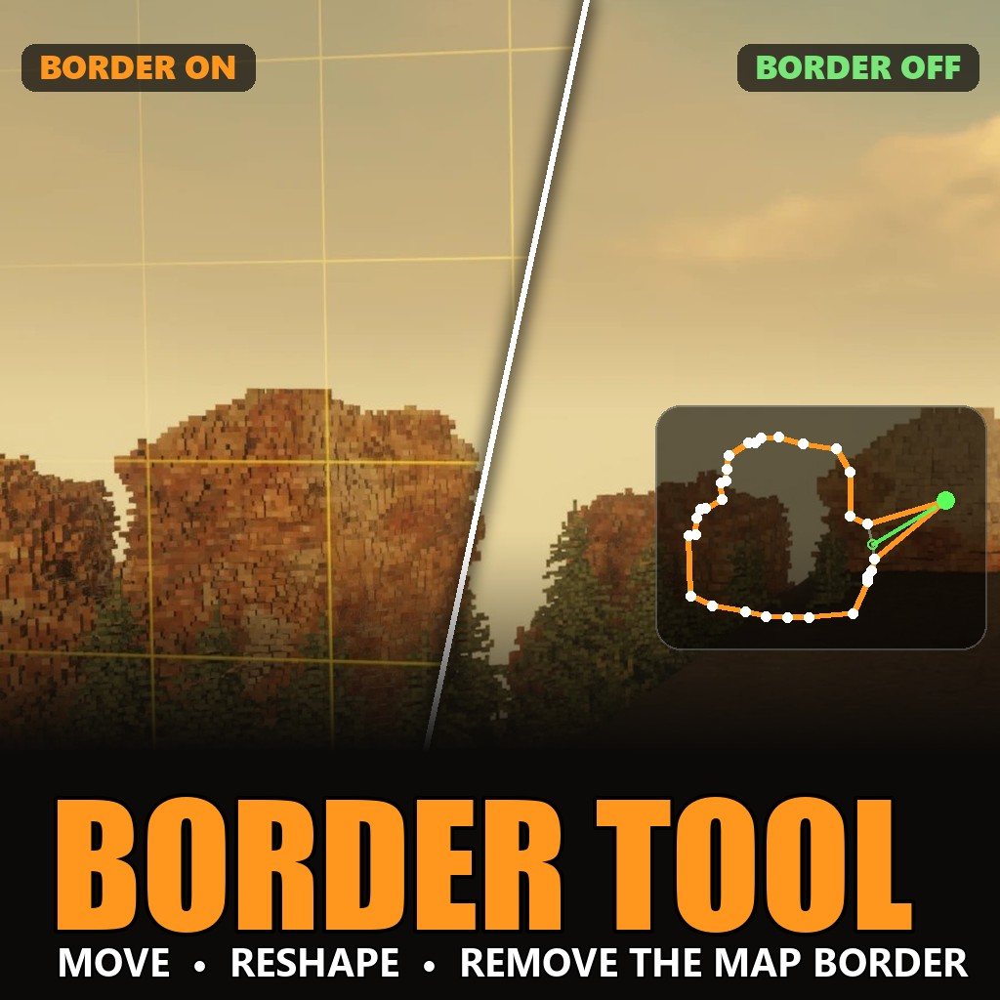

# Border Tool for Teardown

Move, reshape or completely remove the map border (the orange grid wall) in any Teardown level, right from inside the game.

Teardown's mod scripts can only *read* the level border, not change it. So this mod comes in two parts:

- **The Border Tool mod** - the tool you hold in the game ([Steam Workshop](https://steamcommunity.com/sharedfiles/filedetails/?id=3816592910), or the `BorderTool` folder in the download).
- **BorderTool.exe** - a small helper program that runs next to the game and applies your changes. The tool does nothing without it.

## Download

Get the latest zip from **[Releases](https://github.com/markos12900-beep/teardown-border-tool/releases/latest)**.

## Install

1. Unzip it anywhere (for example your Desktop).
2. Install the mod, either way:
   - Subscribe to **[Border Tool on the Steam Workshop](https://steamcommunity.com/sharedfiles/filedetails/?id=3816592910)**, **or**
   - copy the `BorderTool` folder into `Documents\Teardown\mods\`.
3. In Teardown, open **Mods** and enable **Border Tool**.

## Use

1. Start **BorderTool.exe**. It can be before or after the game, because it waits for Teardown and connects by itself. Keep its window open while you play.
2. Load any level and pick **Border Tool** from your tools.

| Control | What it does |
|---|---|
| **LMB** (hold) | drag the nearest corner (it turns green) |
| **RMB** (hold) | drag the whole border |
| **N** | add a corner where you aim |
| **B** | delete the corner you aim at |
| **T / G** | make the border bigger / smaller |
| **X** | remove / restore the border |
| **R** | reset to the level's original border |

While you hold the tool, the border's outline is drawn in orange with a white post at every corner.

## Good to know

- Your changes last until you restart or leave the level. No game files are changed.
- A border can have up to 48 corners.
- Single-player only.
- BorderTool.exe works by reading and writing Teardown's memory while the game runs, so some antivirus programs may warn about it. It only opens `teardown.exe` and nothing else.
- After a big Teardown update the helper may stop working. Its window then says that it needs an update, and it doesn't change anything.

## Problems?

Open an [issue](https://github.com/markos12900-beep/teardown-border-tool/issues). Include the level name and what the BorderTool.exe window says.

## Credits

Made by markos12900-beep (with Claude). Released under the [MIT licence](LICENSE).

This is an unofficial fan project, not affiliated with or endorsed by Tuxedo Labs. Teardown and its assets belong to Tuxedo Labs.
